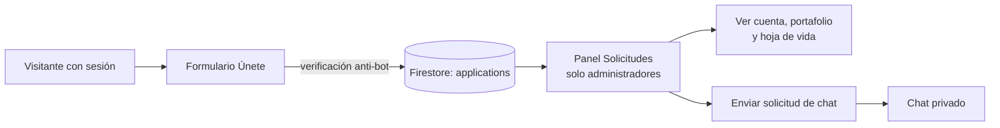

<div align="center">


# Deytek Software

**Estudio independiente de videojuegos · Comunidad · Cuentas · Chat**

Una web con estética *liquid glass* en blanco y negro, foro, amigos con chat, catálogo de juegos y reclutamiento de colaboradores. Sin frameworks, sin proceso de compilación.

<br>


[🌐 Sitio web](https://deyteksoftware.com) · [🐞 Reportar un problema](../../issues) · [💡 Sugerir una mejora](../../issues)

</div>

---

## 📑 Contenido

- [✨ Características](#-características)
- [🧭 Guía de uso](#-guía-de-uso)
- [🚀 Inicio rápido](#-inicio-rápido)
- [🔥 Configurar Firebase](#-configurar-firebase)
- [🌐 Publicar el sitio](#-publicar-el-sitio)
- [🎮 Agregar juegos](#-agregar-juegos)
- [👥 Colaboradores (Equipo)](#-colaboradores-equipo)
- [🛡️ Administradores y solicitudes](#️-administradores-y-solicitudes)
- [💬 Amigos, chat y llamadas](#-amigos-chat-y-llamadas)
- [🗣️ Foro de la comunidad](#️-foro-de-la-comunidad)
- [🎵 Sonido y música](#-sonido-y-música)
- [🗂️ Estructura del proyecto](#️-estructura-del-proyecto)
- [🧱 Base de datos](#-base-de-datos)
- [🩺 Solución de problemas](#-solución-de-problemas)
- [🔒 Seguridad](#-seguridad)
- [🤝 Contribuir](#-contribuir)
- [📄 Licencia](#-licencia)

---

## ✨ Características

| | |
|---|---|
| 🎨 **Diseño liquid glass** | Vidrio esmerilado, fondo en video, animaciones al hacer scroll y versión completa para celular. |
| 🔎 **Búsqueda global** | Encuentra juegos, personajes, vacantes y secciones. Atajo `Ctrl + K`. |
| 🎮 **Catálogo de juegos** | Filtros por género, ficha con tráiler, galería, personajes destacados y botón **Obtener juego** por plataforma. |
| 👤 **Cuentas** | Inicio de sesión con **Google** o correo y contraseña, foto de perfil (incluye GIF) y un **ID único** `DTK-12345`. |
| 🗣️ **Foro** | Comentarios con tema, calificación de 1 a 5 estrellas, respuestas y me gusta / no me gusta. |
| 💬 **Amigos y chat** | Solicitudes de amistad por ID, chat privado con fotos, GIFs y videos, bloqueos y llamadas. |
| 👥 **Colaboradores** | La sección Equipo se arma sola a partir de una lista de IDs. |
| 📨 **Reclutamiento** | Formulario **Únete** con verificación anti-bot y un panel privado de **Solicitudes** para administradores. |
| 🎵 **Sonido** | Efectos y música ambiental generados en el navegador, con interruptor. |

---

## 🧭 Guía de uso

| Quiero... | Hago esto |
|---|---|
| **Crear una cuenta** | Botón **Entrar** (arriba a la derecha) → *Continuar con Google* o *Crear cuenta* con correo. |
| **Editar mi perfil** | Toca tu foto → cambia nombre y foto → **Guardar cambios**. Ahí también ves y copias **Tu ID**. |
| **Ver un juego** | Toca su tarjeta: tráiler, fotos, historia, personajes y **Obtener juego**. |
| **Buscar algo** | Barra del menú o `Ctrl + K`. |
| **Opinar en el foro** | Sección **Foro** → elige tema y calificación → escribe → **Publicar** (1 comentario por minuto). |
| **Responder o reaccionar** | **Responder** en cualquier fila, o los botones de me gusta / no me gusta. |
| **Agregar un amigo** | **Amigos** → escribe su ID (`DTK-12345`) → **+**. Cuando acepte, abre el chat. |
| **Postularme al equipo** | Sección **Únete** (requiere sesión) → completa el formulario y pega el enlace a tu hoja de vida. |
| **Apagar la música** | Interruptor **Música** en el pie de página. |

---

## 🚀 Inicio rápido

No necesitas instalar dependencias ni compilar nada. Solo hay que servir los archivos por **http** (el inicio de sesión con Google no funciona abriendo `index.html` con doble clic).

```bash
git clone https://github.com/TU-USUARIO/deytek-software.git
cd deytek-software
npx serve .
```

Abre la dirección que muestra la terminal (normalmente `http://localhost:3000`).
Alternativa: instala la extensión **Live Server** en VS Code y pulsa *Go Live*.

> Antes de que las cuentas, el foro o el chat funcionen, conecta Firebase con la siguiente sección.

---

## 🔥 Configurar Firebase

El proyecto usa **Firebase Authentication** y **Cloud Firestore**. Funciona con el plan gratuito *Spark*.

1. **Crea el proyecto** en [console.firebase.google.com](https://console.firebase.google.com).
2. **Registra una app web** (ícono `</>`) y copia la configuración en `firebase-config.js`:

   ```js
   window.FIREBASE_CONFIG = {
     apiKey: "...",
     authDomain: "tu-proyecto.firebaseapp.com",
     projectId: "tu-proyecto",
     storageBucket: "tu-proyecto.firebasestorage.app",
     messagingSenderId: "...",
     appId: "..."
   };
   ```

3. **Activa el acceso:** *Authentication → Método de acceso* → habilita **Google** y **Correo electrónico/contraseña**.
4. **Crea la base de datos:** *Firestore Database → Crear base de datos* → **modo producción**.
5. **Publica las reglas:** en la pestaña **Reglas** pega todo el contenido de [`firestore.rules`](firestore.rules) y pulsa **Publicar**. Antes, configura los administradores (ver [Administradores](#️-administradores-y-solicitudes)).
6. **Dominios autorizados:** *Authentication → Configuración → Dominios autorizados*. `localhost` ya viene incluido; agrega aquí tu dominio de producción.

<details>
<summary><b>📦 Firebase Storage (opcional)</b></summary>

Solo se usa para enviar **GIFs (hasta 10 MB) y videos (hasta 25 MB)** en el chat, en la ruta `chatmedia/`. Las imágenes normales se comprimen y se guardan directamente en Firestore, y todo lo demás funciona sin Storage.

Si lo quieres activar, habilita Storage en tu proyecto (según el proyecto puede requerir el plan *Blaze*) y crea reglas que permitan a usuarios autenticados escribir en `chatmedia/`.

</details>

---

## 🌐 Publicar el sitio

Es un sitio estático: sirve en cualquier hosting (Firebase Hosting, GitHub Pages, Netlify, Vercel…).

**Con Firebase Hosting:**

```bash
npm install -g firebase-tools
firebase login
firebase init hosting     # directorio público: .   ·   ¿Sobrescribir index.html? → NO
firebase deploy --only hosting
```

Después de publicar:

- Agrega tu dominio en *Authentication → Dominios autorizados*.
- Recarga con `Ctrl + F5` para saltarte la caché y ver la versión nueva.

---

## 🎮 Agregar juegos

Edita el arreglo `games` en [`script.js`](script.js). Cada tarjeta, filtro, ficha y resultado de búsqueda se genera solo.

```js
{
  n: "Nombre del juego",
  g: "Terror",                         // género: crea el filtro automáticamente
  y: 2025,
  p: "PC · Móvil",
  d: "Descripción corta para la tarjeta.",
  a: "linear-gradient(135deg,#2a2a2e,#000)",   // fondo si no hay imagen
  img: "img/portada.png",              // imagen principal
  shots: ["img/foto1.png", "img/foto2.png"],   // galería
  video: "https://www.youtube.com/embed/ID",  // o "img/trailer.mp4"
  info: "Descripción larga que aparece en la ficha.",
  characters: [
    { n: "Nombre", r: "Rol", img: "img/personaje.png",
      data: { Altura: "1,80 m", Edad: "27 años", Origen: "Colombia" },
      story: "Historia del personaje." }
  ],
  links: { steam: "https://...", android: "https://...", pc: "https://..." }
}
```

**Claves válidas en `links`:** `steam` · `ps` · `xbox` · `switch` · `epic` · `ios` · `android` · `pc`.
Una clave que no esté en esta lista no muestra botón. Si no pones ningún enlace, la ficha muestra **Próximamente**.

Las imágenes y videos van en la carpeta [`img/`](img).

---

## 👥 Colaboradores (Equipo)

La sección **Colaboradores** lee el nombre y la foto de cada persona desde su cuenta. Tú solo decides **quién aparece y con qué cargo**, usando su ID.

**Paso a paso**

1. La persona crea su cuenta e inicia sesión en el sitio (así se le genera su ID).
2. Le pides su **ID**: toca su foto → en su perfil aparece **Tu ID** → **Copiar** (formato `DTK-12345`).
3. Agrégala al arreglo `team` de [`script.js`](script.js):

   ```js
   const team = [
     { id: "DTK-12345", r: "Programador" },
     { id: "DTK-67890", r: "Diseñador gráfico" },
     { id: "DTK-24680", r: "Música y sonido" },
   ];
   ```

4. Guarda y publica el sitio. Aparece su tarjeta con foto, nombre y cargo.

**Cosas que conviene saber**

- Si la persona cambia su nombre o foto en su perfil, la tarjeta se actualiza sola.
- Solo aparecen los IDs que estén en la lista. Para quitar a alguien, borra su línea.
- El orden de las tarjetas es el orden del arreglo.
- Si un ID no existe, simplemente se omite. Si la lista está vacía o ningún ID coincide, se muestra *"Estamos armando el equipo"*.
- Los visitantes sin sesión también ven al equipo, porque el perfil público (`users`) es de lectura abierta en las reglas.

---

## 🛡️ Administradores y solicitudes

Los administradores ven un botón extra, **Solicitudes**, con las postulaciones del formulario **Únete**.

### Cómo funciona



### Cómo hacer administrador a alguien

Hay que dar de alta la **misma cuenta en dos lugares** (el panel se muestra por uno y los datos se protegen por el otro):

**1. Su ID `DTK-xxxxx`, en [`script.js`](script.js)** — controla que se muestre el botón:

```js
const ADMIN_IDS = ["DTK-12345", "DTK-67890"];
```

**2. Su UID de Firebase, en [`firestore.rules`](firestore.rules)** — controla quién puede leer las solicitudes:

```js
function isAdmin() {
  return signed() && request.auth.uid in [
    "UID_DEL_ADMIN_1",
    "UID_DEL_ADMIN_2"
  ];
}
```

El UID lo ves en *Firebase Console → Authentication → Usuarios → «UID de usuario»*. **No es** el `DTK-xxxxx`.

Después, copia el contenido de `firestore.rules` en *Firestore → Reglas* y pulsa **Publicar**.

> ⚠️ Si pones el ID en un lugar y el UID de otra cuenta en el otro, el botón aparece pero las solicitudes no cargan (`permission-denied`), o al revés.

### Qué ve el administrador

Cada solicitud muestra:

- 👤 La **cuenta** de quien la envió: foto, nombre de perfil e ID.
- 📝 Nombre, correo, área de interés y mensaje.
- 🔗 Botones **Ver portafolio** y **Ver hoja de vida** (enlaces).
- 💬 Botón para hablar con la persona:

  | Estado | Botón |
  |---|---|
  | Aún no son amigos | **Enviar solicitud de chat** |
  | Ya le enviaste la solicitud | **Solicitud enviada** |
  | Ella te la envió a ti | **Aceptar su solicitud** |
  | Ya son amigos | **Abrir chat** |

- ✅ **Marcar como vista / nueva** y 🗑️ **Borrar**.

### Qué llena el postulante

Nombre completo · correo · área de interés · portafolio (opcional) · mensaje · **enlace a la hoja de vida** (Drive, Dropbox, Notion…). Debe tener la sesión iniciada. Las áreas disponibles se editan en el arreglo `roles` de [`script.js`](script.js).

> 💡 La hoja de vida se pide como **enlace**, no como archivo: así no hace falta Storage ni se guardan documentos personales en tu base de datos. Pide a los postulantes que compartan el enlace con permiso de lectura.

---

## 💬 Amigos, chat y llamadas

- **Agregar amigos** con su ID `DTK-12345` (o con su nombre exacto). La otra persona acepta o rechaza.
- **Chat privado** entre amigos: texto, imágenes (se comprimen a ≤ 500 KB), GIFs (≤ 10 MB) y videos (≤ 25 MB).
- **Bloquear** a un usuario desde la conversación.
- **Llamadas** con WebRTC: cámara, micrófono y pantalla compartida.
- En el celular, la lista y el chat se muestran uno a la vez.

> Los mensajes son privados entre los dos amigos: las reglas de Firestore impiden que otras cuentas los lean.

---

## 🗣️ Foro de la comunidad

- Publicar requiere sesión. Cada comentario lleva **tema**, **calificación** (1–5 ★) y texto (máx. 600 caracteres).
- Se puede **responder**, dar **me gusta / no me gusta** (una reacción por usuario) y **borrar** el propio comentario.
- **Límite de 1 comentario por minuto** por usuario, validado también en el servidor (colección `limits` + reglas).
- Los temas se editan en `TOPICS`, al inicio de [`comunidad.js`](comunidad.js).
- Para moderar comentarios ajenos, bórralos desde *Firebase Console → Firestore*.

---

## 🎵 Sonido y música

[`fx.js`](fx.js) genera los sonidos de botones, un sonido especial al tocar un juego y una música ambiental, todo con Web Audio, sin archivos de audio.

Está **desactivado por defecto**. Para activarlo, descomenta esta línea al final de `index.html`:

```html
<script src="fx.js"></script>
```

La música empieza tras el primer clic de la persona (los navegadores no permiten audio antes) y el interruptor del pie de página recuerda su elección. Para usar tu propia canción, escribe su ruta en `MUSIC_FILE`, dentro de `fx.js`.

---

## 🗂️ Estructura del proyecto

```
deytek-software/
├── index.html           Estructura de la página y los cuadros de diálogo
├── styles.css           Diseño liquid glass
├── mobile.css           Ajustes para celular
├── script.js            Datos editables (juegos, equipo, vacantes, admins), búsqueda y formulario Únete
├── auth.js              Cuentas: Google / correo, perfil, foto e ID único
├── social.js            Amigos y chat
├── call.js              Llamadas (WebRTC)
├── comunidad.js         Foro
├── extras.js            Fichas de juegos, animaciones y bloqueo del formulario
├── equipo.js            Colaboradores a partir de IDs
├── solicitudes.js       Panel de administradores
├── fx.js                Sonidos y música (opcional)
├── firebase-config.js   Configuración de tu proyecto Firebase
├── firestore.rules      Reglas de seguridad
└── img/                 Logo, imágenes, videos y fondo
```

---

## 🧱 Base de datos

| Colección | Para qué sirve | Quién accede |
|---|---|---|
| `users` | Perfil público: nombre, foto, ID | Lectura pública · escribe solo su dueño |
| `posts` · `replies` | Foro | Lectura pública · escriben usuarios con sesión |
| `limits` | Control de 1 comentario por minuto | Cada usuario, solo la suya |
| `applications` | Solicitudes del formulario Únete | Crea cualquier usuario con sesión · lee solo el administrador |
| `friendships` · `blocks` | Amistades y bloqueos | Solo las personas involucradas |
| `chats/{id}/messages` | Mensajes privados | Solo los dos amigos |
| `rooms` · `invites` | Señalización de llamadas | Solo los participantes |

---

## 🩺 Solución de problemas

| Síntoma | Causa probable y solución |
|---|---|
| *Entrar con Google* falla | Abre el sitio desde `http://localhost` o tu dominio (no como archivo). Revisa *Dominios autorizados* y desactiva el bloqueo de ventanas emergentes. |
| `auth/unauthorized-domain` | Agrega el dominio en *Authentication → Dominios autorizados*. |
| `permission-denied` en foro o chat | Las reglas no están publicadas o no son las de `firestore.rules`. |
| No me aparece **Solicitudes** | Tu `DTK-xxxxx` no está en `ADMIN_IDS` de `script.js`. Copia el ID exacto desde tu perfil. |
| **Solicitudes** carga con error | Tu UID no está en `isAdmin()` de las reglas, o no las publicaste. |
| Subí cambios y no se ven | Recarga con `Ctrl + F5`, o vuelve a publicar el hosting. |
| No aparece un colaborador | Su ID está mal escrito o aún no ha iniciado sesión. Revisa también que `users` sea de lectura pública. |
| El botón de una plataforma no sale | La clave en `links` no es válida. Usa `steam`, `ps`, `xbox`, `switch`, `epic`, `ios`, `android` o `pc`. |
| Los GIFs o videos del chat no suben | Falta habilitar Firebase Storage y sus reglas para `chatmedia/`. |

---

## 🔒 Seguridad

- La `apiKey` de Firebase **no es un secreto**: identifica el proyecto. La protección real está en las **reglas de Firestore**, así que publícalas siempre.
- El perfil público (`users`) expone solo nombre, foto e ID. El correo no se guarda ahí.
- El acceso de administrador se valida **dos veces**: en la interfaz (`ADMIN_IDS`) y en el servidor (`isAdmin()` en las reglas).
- Todo texto de usuarios se escapa antes de mostrarse en la página.
- No subas a GitHub credenciales privadas ni cuentas de servicio.

Si encuentras una vulnerabilidad, repórtala de forma privada al equipo antes de hacerla pública.

---

## 🤝 Contribuir

1. Haz un *fork* del repositorio.
2. Crea una rama: `git checkout -b mejora/mi-cambio`
3. Haz tus cambios y un *commit* claro.
4. Abre un *Pull Request* explicando qué cambia y por qué.

El proyecto usa **HTML, CSS y JavaScript puros**, sin pasos de compilación. Mantén ese enfoque.

---

## 📄 Licencia

© 2026 Deytek Software · Colombia. Todos los derechos reservados.

<div align="center">

Hecho con 🖤 por **Deytek Software**

</div>